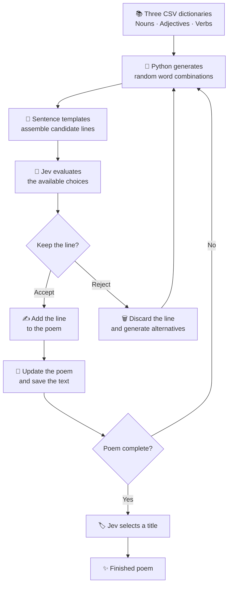

# 🎭 Jev Poet

### They say Jev cannot generate text, so who wrote this poem?

**Jev Poet is an experiment in making a model do something it wasn't designed to do: create poetry.**

Instead of asking Jev to write a poem from scratch, Python generates possibilities and Jev decides which ones deserve to stay.

Python proposes. Jev judges. The poem emerges from the choices.

## 💡 The idea

Jev is used as a selection mechanism inside a small generative poetry system. It doesn't need to invent the text directly. It only needs to recognize which combinations of words, images, and phrases are worth keeping.

The experiment combines three ingredients:

- 🎲 **Randomness** — Python creates unexpected combinations.
- 🧩 **Structure** — sentence templates provide a framework for the words.
- 🧠 **Judgment** — Jev evaluates alternatives and decides what to keep or discard.

The goal is not conventional storytelling. It is to discover whether unexpected associations can develop into something that feels like a poem.

## 📚 Three dictionaries

The project starts with three CSV word lists:

| Dictionary | Contents |
|---|---|
| 🏷️ **Nouns** | Objects, animals, places, materials, and other potential poetic images |
| 🎨 **Adjectives** | Colors, textures, qualities, and descriptions |
| ⚡ **Verbs** | Actions, movements, transformations, and events |

Python combines words from these dictionaries using sentence templates.

For example:

```text
The {adjective} {noun} {verb} beneath the {noun}.
```

A randomly generated candidate might be:

> The frozen eel sleeps beneath the lighthouse.

Another might be completely absurd. That is intentional: Python generates possibilities, not finished poetry.

## 🔄 How it works



## 🧠 What does Jev actually decide?

Depending on the generation mode, Jev participates in several decisions:

1. **Word selection:** chooses nouns, verbs, and adjectives from candidate lists to fill sentence structures.
2. **Line selection:** compares complete candidate lines and selects the strongest one.
3. **Acceptance or rejection:** evaluates whether an assembled line is worth keeping.
4. **Stanza development:** can choose recurring images and decide when a stanza should end.
5. **Title selection:** chooses a title that reflects the poem's imagery and recurring motifs.

Jev receives the poem so far as context. This helps it recognize recurring images and evaluate new lines in relation to what has already been written.

The selection criteria favor concrete imagery, unexpected but imaginable associations, rhythm, ambiguity, and variation. A strange combination is not automatically a good one.

### ✅ Keep

A line with an evocative image, an unexpected relationship, or a meaningful connection to previous lines.

### 🗑️ Discard

A line that is awkward, meaningless, repetitive, or less interesting than the alternatives.

Rejected lines are discarded, and Python generates new candidates. The poem develops through successive decisions rather than following a predetermined story.

## 🌀 Why surrealism?

Consider a line such as:

> My spine became a lighthouse.

It does not describe a realistic event, yet it offers a concrete image. The body becomes architecture, and the transformation invites interpretation without explaining itself.

This is the kind of result the experiment seeks: not merely unusual vocabulary, but unexpected relationships between otherwise familiar things.

Recurring images also matter. A lighthouse, an eel, or a frozen candle can return throughout a poem, gradually acquiring new associations. The result can feel coherent without requiring conventional narrative logic.

## ⚙️ Implementation

- 🐍 **Python** handles vocabulary, templates, word forms, candidate generation, and saving.
- 🔌 **Jev through OpenRouter** evaluates the alternatives and returns decisions.
- 🎲 **Random sampling** keeps the candidate pool unpredictable.
- 🧠 **Context and recurring motifs** help Jev evaluate each new line.
- 💾 **Incremental saving** preserves the poem as it develops.
- 💰 **Cost reporting** tracks the API usage reported by the service.

The experiment includes two approaches: `words` mode, which lets Jev choose words and evaluate the assembled line, and `lines` mode, which lets Jev select from complete candidate lines.

## ❓ The central question

Can a model contribute to a creative process without being asked to perform the task in the conventional way it was designed for?

Jev doesn't have to write the poem directly. Python generates the possibilities, and Jev makes the selections. The final result emerges from the interaction between algorithmic chance and model-based judgment.

The system is neither entirely random nor entirely controlled. Sometimes the result is awkward. Sometimes it is nonsense. Occasionally, a combination of words becomes unexpectedly memorable.

That is the point of the experiment.

---

### ✍️ Created by Roni Bandini

🌐 [GitHub](https://github.com/ronibandini) · 𝕏 [@ronibandini](https://x.com/RoniBandini)

**They say Jev cannot generate text, so who wrote this poem?**
